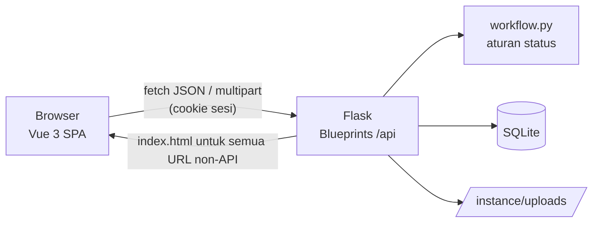
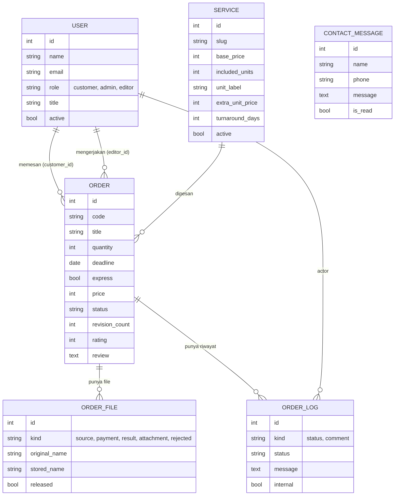
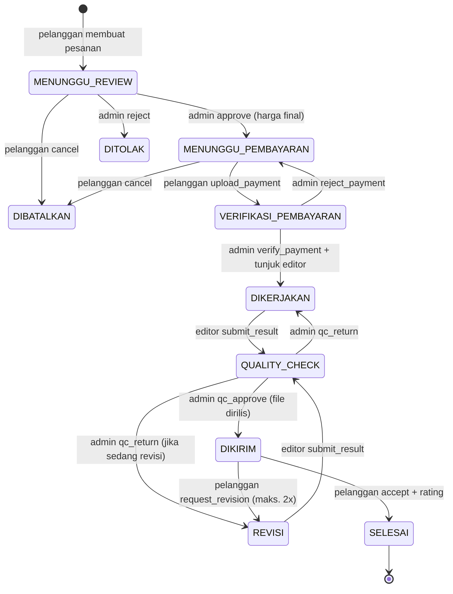

# Dokumentasi Pengembangan — Academic Support Service

Dokumen ini untuk anggota tim yang akan melanjutkan, memodifikasi, atau men-deploy aplikasi.
Untuk cara memakai aplikasi (pelanggan, admin, editor), lihat [PANDUAN-PENGGUNAAN.md](PANDUAN-PENGGUNAAN.md).

---

## 1. Ringkasan

Aplikasi web yang menggabungkan **company profile** dan **sistem pemesanan jasa** Academic Support Service
(editing & proofreading, formatting, presentation support, tutoring). Seluruh proses bisnis, dari pesanan masuk
sampai hasil diterima pelanggan, tercatat di sistem.

| Lapisan | Teknologi | Keterangan |
|---|---|---|
| Backend | Python 3.10+ · Flask 3.1 · Flask-SQLAlchemy 3.1 | REST API JSON di `/api/*`, sesi berbasis cookie |
| Database | SQLite (default) | File `instance/academic_support.db`, bisa diganti lewat `DATABASE_URL` |
| Frontend | Vue 3 + Vue Router 4 (build global, **tanpa build step**) | Single Page Application, file di `app/static/` |
| Tampilan | CSS murni (`style.css`) + font Plus Jakarta Sans | Responsif untuk desktop dan ponsel |

Vue dan Vue Router di-*vendor* di `app/static/vendor/`, sehingga aplikasi tidak butuh Node.js/npm dan tetap bisa
berjalan tanpa CDN. Hanya font yang dimuat dari Google Fonts; bila offline, browser memakai font sistem.

---

## 2. Menjalankan untuk pengembangan

```bash
python -m venv .venv
.venv\Scripts\activate                 # Linux/macOS: source .venv/bin/activate
pip install -r requirements-dev.txt    # Flask, Flask-SQLAlchemy, pytest
python run.py --demo                   # isi data demo (jika DB kosong) lalu jalankan
```

| Perintah | Fungsi |
|---|---|
| `run.bat` / `./run.sh` | Sekali klik: buat venv, pasang dependensi, isi demo, jalankan, buka browser |
| `python run.py` | Jalankan server di http://127.0.0.1:5000 (mode debug) |
| `python run.py --demo` | Isi 10 pesanan demo di berbagai status bila database belum berisi pesanan |
| `python run.py --reset --demo` | Hapus database & file unggahan, lalu isi ulang demo |
| `python -m pytest` | Jalankan test otomatis (`tests/`) |

Variabel lingkungan: `PORT` (default 5000), `FLASK_DEBUG` (`1`/`0`), `SECRET_KEY`, `DATABASE_URL`.

> **Catatan Windows:** di komputer dengan *Application Control*, ekstensi C SQLAlchemy di dalam `.venv` bisa diblokir
> (`DLL load failed ... blocked`). `app/__init__.py` otomatis mengatur `DISABLE_SQLALCHEMY_CEXT_RUNTIME=1`
> sehingga SQLAlchemy memakai implementasi pure-Python. Fungsinya sama dan tidak perlu tindakan apa pun.

---

## 3. Struktur proyek

```
academic-support/
├── app/
│   ├── __init__.py        create_app(): konfigurasi, registrasi blueprint, SPA fallback, seed awal
│   ├── extensions.py      objek db (SQLAlchemy)
│   ├── models.py          User, Service, Order, OrderFile, OrderLog, ContactMessage
│   ├── workflow.py        status pesanan, aturan aksi per peran, perhitungan harga, pencatatan log
│   ├── utils.py           login_required, simpan unggahan, aturan akses file/pesanan
│   ├── seed.py            data awal: 5 layanan + akun tim (dibuat otomatis bila DB kosong)
│   ├── demo.py            data demo (python run.py --demo)
│   ├── routes/
│   │   ├── auth.py        /api/auth/*
│   │   ├── public.py      /api/services, /api/quote, /api/testimonials, /api/contact, /api/meta
│   │   ├── orders.py      /api/orders/*, /api/files/*  (inti proses bisnis)
│   │   └── admin.py       /api/admin/*  (ringkasan, staf, layanan, pesan kontak)
│   └── static/
│       ├── index.html     kerangka SPA
│       ├── css/style.css
│       ├── vendor/        vue.global.prod.js, vue-router.global.prod.js
│       └── js/
│           ├── main.js        router, layout (navbar/footer), guard login & peran
│           ├── api.js         fetch wrapper, state global (store), helper format
│           ├── components.js  Icon, StatusBadge, OrderStepper, ServiceCard, EmptyState
│           └── pages/         public.js, auth.js, dashboard.js, order-new.js, order-detail.js, admin.js
├── tests/test_flow.py     test alur bisnis
├── docs/                  dokumentasi + screenshot
├── instance/              (dibuat otomatis) database & folder uploads/ — jangan di-commit
├── run.py · run.bat · run.sh
└── requirements.txt · requirements-dev.txt
```

---

## 4. Arsitektur



- Semua URL selain `/api/*` dan `/static/*` mengembalikan `index.html`; Vue Router (history mode) yang menentukan
  halaman. Karena itu URL seperti `/pesanan/4` bisa di-*refresh* langsung.
- Autentikasi memakai sesi Flask (cookie `HttpOnly`, `SameSite=Lax`). Sesi hanya menyimpan `uid`.
- Error API selalu berbentuk `{"error": "pesan"}` dengan kode HTTP yang sesuai. Frontend menampilkannya sebagai toast.

---

## 5. Model data



Catatan penting:
- `Order.code` berformat `ASS-YYMMDD-NNNN`, dibuat setelah insert (`orders.py:create_order`).
- File disimpan dengan nama acak (`uuid4`) di `instance/uploads/`; nama asli disimpan di `original_name`.
- `OrderFile.released` = `True` setelah hasil lolos quality check. Hasil yang dikembalikan QC diubah jenisnya menjadi `rejected`.
- `OrderLog.internal` = catatan yang hanya terlihat admin & editor.
- Tabel dibuat dengan `db.create_all()`. Tidak ada migrasi; bila mengubah kolom saat pengembangan, jalankan `python run.py --reset`.
  Untuk produksi dengan data nyata, tambahkan Flask-Migrate.

---

## 6. Proses bisnis (state machine)

Semua aturan ada di `app/workflow.py` dan dijalankan oleh endpoint tunggal `POST /api/orders/<id>/action`.



| Aksi | Peran | Dari status | Data wajib |
|---|---|---|---|
| `cancel` | pelanggan (pemilik) | MENUNGGU_REVIEW, MENUNGGU_PEMBAYARAN | – |
| `approve` | admin | MENUNGGU_REVIEW | `price` (opsional, override), `message` |
| `reject` | admin | MENUNGGU_REVIEW | `message` (alasan) |
| `upload_payment` | pelanggan | MENUNGGU_PEMBAYARAN | `payment_method`, `file` (jpg/png/webp/pdf) |
| `verify_payment` | admin | VERIFIKASI_PEMBAYARAN | `editor_id` |
| `reject_payment` | admin | VERIFIKASI_PEMBAYARAN | `message` |
| `submit_result` | editor yang ditugaskan | DIKERJAKAN, REVISI | `files` (≥1), `message` |
| `qc_approve` | admin | QUALITY_CHECK | `message` (opsional) |
| `qc_return` | admin | QUALITY_CHECK | `message` |
| `request_revision` | pelanggan | DIKIRIM (sisa revisi > 0) | `message`, `file` (opsional) |
| `accept` | pelanggan | DIKIRIM | `rating` 1–5, `review`, `show_testimonial` |
| `assign_editor` | admin | DIKERJAKAN, REVISI, QUALITY_CHECK | `editor_id` |

Aksi yang tidak diizinkan mengembalikan **409**. Data tidak lengkap mengembalikan **400**. Respons sukses berisi
pesanan terbaru, termasuk `actions` (daftar aksi yang boleh dilakukan user saat ini). Frontend hanya menampilkan
tombol untuk aksi yang ada di daftar tersebut.

### Aturan harga

```
harga = base_price + max(0, jumlah − included_units) × extra_unit_price
jika ekspres: harga × 1,5
```
Pesanan otomatis menjadi ekspres bila sisa hari ke deadline < `turnaround_days` layanan. Admin dapat mengubah harga
final saat `approve`.

### Hak akses

| Data | Pelanggan (pemilik) | Editor (yang ditugaskan) | Admin |
|---|---|---|---|
| Lihat pesanan | ✔ miliknya | ✔ yang ditugaskan | ✔ semua |
| Dokumen pelanggan / lampiran | ✔ | ✔ | ✔ |
| Bukti pembayaran | ✔ | ✘ | ✔ |
| Hasil pekerjaan | hanya setelah lolos QC | ✔ | ✔ |
| Draf ditolak QC | ✘ | ✔ | ✔ |
| Catatan internal | ✘ | ✔ | ✔ |
| Kontak pelanggan (email, HP) | – | ✘ | ✔ |

Diatur di `utils.can_see_order` dan `utils.can_see_file`. File diunduh lewat `GET /api/files/<id>`, yang memeriksa hak akses
dengan aturan yang sama. Folder uploads tidak pernah disajikan langsung.

---

## 7. Referensi API

Semua respons JSON. Endpoint bertanda 🔒 wajib login (401 bila belum).

**Autentikasi** — `routes/auth.py`

| Method | Path | Keterangan |
|---|---|---|
| POST | `/api/auth/register` | `{name, email, phone, password}` → buat akun pelanggan & login |
| POST | `/api/auth/login` | `{email, password}` |
| POST | `/api/auth/logout` | |
| GET | `/api/auth/me` | `{user}` atau `{user: null}` |

**Publik** — `routes/public.py`

| Method | Path | Keterangan |
|---|---|---|
| GET | `/api/services` | layanan aktif |
| GET | `/api/meta` | label status, metode pembayaran, gaya sitasi |
| GET | `/api/quote?service_id=&quantity=&express=` | `{price}` |
| GET | `/api/testimonials` | ulasan yang diizinkan tampil + statistik |
| POST | `/api/contact` | `{name, email/phone, subject, message}` |

**Pesanan** — `routes/orders.py`

| Method | Path | Keterangan |
|---|---|---|
| GET 🔒 | `/api/orders?status=&q=` | daftar sesuai peran; `status=active` atau daftar dipisah koma |
| POST 🔒 pelanggan | `/api/orders` | multipart: `service_id, title, course, quantity, citation_style, language, deadline (YYYY-MM-DD), express, notes, integrity_agreed=true, files[]` |
| GET 🔒 | `/api/orders/<id>` | detail + `files`, `logs`, `actions` |
| POST 🔒 | `/api/orders/<id>/action` | multipart/JSON: `action` + data (lihat tabel §6) |
| POST 🔒 | `/api/orders/<id>/comments` | `{message, internal}`; `internal` diabaikan untuk pelanggan |
| GET 🔒 | `/api/files/<id>` | unduh file (cek hak akses) |

**Admin** — `routes/admin.py` (peran admin, kecuali disebut lain)

| Method | Path | Keterangan |
|---|---|---|
| GET | `/api/admin/summary` | admin: jumlah per status, ekonomi unit bulan ini, titik impas, beban editor. Editor: ringkasan tugasnya |
| GET | `/api/admin/editors` | editor aktif |
| GET / POST | `/api/admin/users` | daftar user / buat akun staf `{name, email, role, title, phone, password}` |
| PATCH | `/api/admin/users/<id>` | `{active}` aktif/nonaktifkan |
| GET / PUT | `/api/admin/services[/<id>]` | daftar / ubah harga, unit, hari, status aktif |
| GET / PATCH | `/api/admin/messages[/<id>]` | pesan kontak / tandai dibaca |

---

## 8. Frontend

- **Tanpa bundler.** `index.html` memuat Vue & Vue Router global, lalu `js/main.js` sebagai ES module.
  Komponen ditulis sebagai objek `{ data, computed, methods, template }` dengan template string.
  (Flask dipaksa mengirim `.js` sebagai `application/javascript`, karena registry Windows kadang memetakannya ke `text/plain`.)
- **State global** ada di `api.js → store` (`user`, `meta`, `toast`). Helper: `api()`, `notify()`, `rupiah()`, `formatDate()`.
- **Routing & guard** di `main.js`: `meta.auth` wajib login (redirect ke `/masuk?next=`), `meta.roles` membatasi peran,
  `meta.guest` untuk halaman masuk/daftar.
- **Halaman aplikasi** dibungkus `DashShell` (sidebar menu per peran).
- **Detail pesanan** (`order-detail.js`) menampilkan panel aksi berdasarkan `order.actions` dari server, lalu memanggil
  `run(action, fields)` yang mengirim `FormData` ke `/action`.

| Rute | Halaman | Akses |
|---|---|---|
| `/`, `/tentang`, `/layanan`, `/kontak` | Company profile | publik |
| `/masuk`, `/daftar` | Autentikasi | tamu |
| `/dashboard` | Dashboard per peran | login |
| `/pesanan`, `/pesanan/:id` | Daftar & detail | login |
| `/pesan` | Form pesanan | pelanggan |
| `/admin?tab=services\|users\|messages` | Kelola | admin |

---

## 9. Panduan modifikasi umum

| Kebutuhan | Yang diubah |
|---|---|
| Ganti nomor WA, email, rekening | `WA_NUMBER` di `js/api.js`; footer di `js/main.js`; `PAYMENT_INFO` di `js/pages/order-detail.js`; halaman kontak di `js/pages/public.js` |
| Ubah harga/layanan | Menu **Kelola** (admin), atau `app/seed.py` untuk data awal |
| Tambah layanan baru | Tambah dict di `seed.py → SERVICES` (lalu `--reset`), atau insert ke tabel `service`. Ikon yang tersedia ada di `ICONS` (`components.js`) |
| Ubah angka ekonomi unit | `VARIABLE_COST_PER_ORDER`, `FIXED_COST_MONTHLY`, `PROMO_BUDGET_MONTHLY`, `CAC_PER_ORDER` di `app/__init__.py` |
| Ubah batas revisi | Default `max_revisions=2` di `models.Order` |
| Tambah status/aksi baru | 1) konstanta + label di `workflow.py` · 2) aturan di `allowed_actions` · 3) fungsi `act_*` + daftarkan di `ACTIONS` (`orders.py`) · 4) panel UI di `order-detail.js` · 5) warna di `STATUS_TONES` dan (opsional) langkah di `STEPS` (`components.js`) · 6) tambah test |
| Ubah tampilan | `static/css/style.css`; warna utama diatur di variabel `:root` |

---

## 10. Testing

```bash
python -m pytest -q
```

`tests/test_flow.py` memakai database in-memory dan folder unggahan sementara, lalu menguji:
- alur lengkap termasuk QC dikembalikan dan revisi pelanggan sampai selesai + testimoni tampil;
- aksi ditolak untuk peran/status yang salah (409) dan data tidak lengkap (400);
- editor tidak bisa melihat bukti pembayaran;
- deadline mepet otomatis menjadi ekspres (+50%);
- pesanan wajib pernyataan integritas dan wajib login.

Status terakhir: **5 passed**. Selain itu, seluruh alur juga sudah dicoba lewat UI di browser (Edge) untuk ketiga peran.

---

## 11. Deployment (produksi)

1. Set `SECRET_KEY` yang acak dan panjang, lalu `FLASK_DEBUG=0`.
2. Ganti kata sandi akun bawaan (lihat `seed.py`) atau buat akun staf baru lalu nonaktifkan akun demo. Jangan jalankan `--demo`.
3. Jalankan dengan server WSGI, bukan `app.run`:
   - Windows: `pip install waitress` → `waitress-serve --port=8000 run:app`
   - Linux: `pip install gunicorn` → `gunicorn -w 2 -b 0.0.0.0:8000 run:app`
   - PythonAnywhere: arahkan WSGI file ke `from run import app as application`.
4. Pasang HTTPS (reverse proxy Nginx/hosting), lalu tambahkan `SESSION_COOKIE_SECURE=True` di konfigurasi.
5. Backup rutin folder `instance/` (database + file unggahan).

---

## 12. Keterbatasan & pengembangan berikutnya

- Belum ada notifikasi email/WhatsApp otomatis saat status berubah (saat ini dipantau lewat dashboard). Kandidat: WhatsApp link otomatis atau SMTP.
- Pembayaran diverifikasi manual (bukti transfer). Kandidat: payment gateway (Midtrans/Xendit) dengan webhook.
- Belum ada fitur lupa kata sandi dan ubah profil.
- Belum ada migrasi database (Flask-Migrate) dan proteksi CSRF berbasis token. Saat ini mitigasinya cookie `SameSite=Lax`.
- Penjadwalan sesi tutoring masih memakai kolom deadline + catatan. Kandidat: kalender slot sesi.
- Batas ukuran unggahan 20 MB per request (`MAX_CONTENT_LENGTH`).
